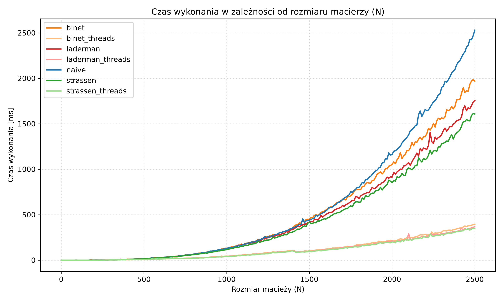

# Matrix Algorithms

Java implementations of recursive matrix algorithms, with benchmarks and written reports.
This is a university course project (*Algorytmy macierzowe*, AGH University of Krakow, Faculty of Computer Science).

**Status: work in progress.** The course gives new tasks over time. Each task builds on the previous one.

## Tasks

| # | Task | Code | Report | Status |
|---|------|------|--------|--------|
| 1 | Matrix multiplication: Binet, Strassen, Laderman | `src/multiplication` | [sprawozdanie_1.pdf](sprawozdania/sprawozdanie_1/sprawozdanie_1.pdf) | Done |
| 2 | Block LU factorization and matrix inversion | `src/factorization`, `src/inversion` | [sprawozdanie_2.pdf](sprawozdania/sprawozdanie_2/sprawozdanie_2.pdf) | Done |
| 3 | Next task from the course | - | - | Planned |
| 4 | Next task from the course | - | - | Planned |

The reports are in Polish.

## How it works

Every algorithm splits a matrix into blocks and calls itself on the blocks.
The recursion stops at a size limit called `leaf`. Below this size, a simple loop does the work.

- **Multiplication.** Binet uses 8 block products. Strassen uses 7. Laderman splits into 3 x 3 blocks and uses 23.
  Any matrix size works, not only powers of 2.
- **LU factorization.** The algorithm has no pivoting. Almost all of its work is matrix multiplication,
  so you can plug in any of the three multiplication methods.
- **Inversion.** The algorithm uses the Schur complement and the same pluggable multiplication.
- **Parallel mode.** Every algorithm has a single-thread version and a `ForkJoinPool` version.
  Both versions do the same floating-point operations.
- **Operation counters.** The code counts every addition and multiplication, so you can compare algorithms
  by operation count and not only by time.
- **No block copies.** A `MatrixView` points into one flat array. A block is a view, not a copy.

## Selected results

LU factorization of a 2500 x 2500 matrix, one thread (from the second report):

| Method | Time | Multiplications vs. classic |
|--------|------|-----------------------------|
| Classic LU | 2529 ms | 100% |
| Binet | 1970 ms | 100% |
| Strassen | 1607 ms | 72.6% |
| Laderman | 1756 ms | 76.0% |

The parallel version is 4.6 to 5 times faster than the single-thread version for the same method.



## Project layout

```
src/
  common/          Matrix, MatrixView, operation counters, test and benchmark helpers
  multiplication/  Binet, Strassen, Laderman
  factorization/   Block LU
  inversion/       Block inversion
utils/             Python scripts: average benchmark runs, draw charts, find the largest matrix size
sprawozdania/      Reports in Typst (source and PDF) with charts
test_data/         Benchmark output (CSV files)
```

## Run it

You need JDK 25 or newer. The project has no build tool.

```bash
javac -d out src/common/*.java src/multiplication/*.java src/factorization/*.java src/inversion/*.java
```

Each task has a `Main` class with the same modes:

| Mode | What it does |
|------|--------------|
| `0` (default) | Run a correctness check and print time and operation counts |
| `1` | Run the benchmark and write CSV files to `test_data/` |
| `2` | Search for the best `leaf` value |

```bash
java -cp out multiplication.Main 0
java -cp out factorization.Main 1
java -cp out inversion.Main 0
```

The Python scripts in `utils/` need Python 3 and `matplotlib`.

```bash
python utils/average_runs.py test_data/multiplication
```

## Notes

- LU has no pivoting. It needs a matrix with nonzero leading principal minors.
  The benchmarks use diagonally dominant matrices, which meet this condition.
- Every algorithm result is compared with a classic algorithm. The reports also compare small cases with Octave.
